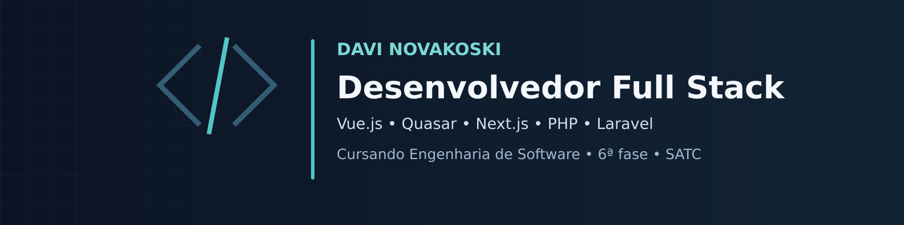

## Olá! Sou o Davi 👋

Sou **Programador Júnior na Supra Sorte**, onde trabalho desde abril de 2024, e estou **cursando a 6ª fase de Engenharia de Software na SATC**.

Tenho experiência com **Vue.js, Quasar Framework e Next.js** no front-end e **PHP e Laravel** no back-end. Busco oportunidades remotas em desenvolvimento de software.

### Tecnologias

`Vue.js` · `Quasar` · `Next.js` · `PHP` · `Laravel`

### Projetos em destaque

| Projeto | O que resolve | Tecnologias |
| --- | --- | --- |
| [JobFlow](https://github.com/davinovakoski11/jobflow) | Organização de candidaturas, etapas de entrevistas e propostas, com modo de demonstração e API autenticada | Vue 3 · Quasar · TypeScript · Laravel 13 · SQLite |
| [DevNotes](https://github.com/davinovakoski11/devnotes) | Biblioteca pessoal de notas em Markdown, com busca, tags, favoritos e backup | Next.js · React · TypeScript |

Os repositórios incluem instruções de execução, capturas de tela, testes e roteiros de estudo. São projetos de portfólio criados com apoio de IA para revisão, estudo e evolução prática.

### Vamos conversar

[Meu LinkedIn](https://www.linkedin.com/in/davi-novakoski-78874a447/)
